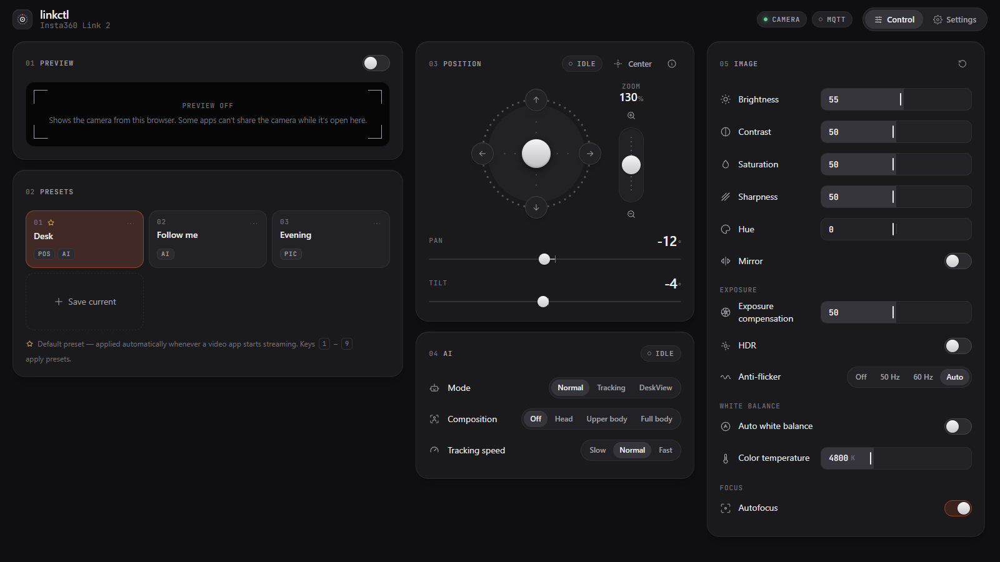

# linkctl

linkctl controls an **Insta360 Link 2** webcam from your browser and from
**Home Assistant**, without the vendor app. It runs in the background with a tray
icon (menu bar icon on macOS), serves a control panel on `localhost`, and
connects to your MQTT broker so the camera shows up in Home Assistant
automatically.

It covers picture settings, pan/tilt/zoom with a joystick, presets, and the
camera's AI modes. It's a single self-contained binary with no drivers and no
runtime dependencies, and it runs alongside Teams, Zoom or OBS while they use the
camera.



## Features

- **Picture:** brightness, contrast, saturation, sharpness, hue, exposure
  compensation, HDR, anti-flicker, white balance (auto or Kelvin), focus (auto
  or manual), mirror.
- **Pan / tilt / zoom:**
  - A joystick with nudge buttons on its ring, a zoom rocker, and keyboard
    control.
  - Movement uses the camera's own speed control, the same way the official
    app does it, so it's smooth. An expo curve gives fine control near the
    center.
- **Presets:**
  - Save position, picture and/or AI settings under a name, and apply them
    from the UI, keys `1`–`9`, or Home Assistant.
  - A *default* preset is applied automatically whenever a video app starts
    using the camera.
- **AI modes:** normal, tracking and DeskView, plus smart composition (head /
  upper body / full body) and tracking speed. Presets can switch between a fixed
  view and tracking.
- **Home Assistant:** MQTT device discovery, so every control becomes an
  entity. There's also an "In use" sensor that's on while any app streams
  video, which is handy for an on-air light.
- **Small things:**
  - Start on login.
  - Single instance: starting it again just opens the panel.
  - The camera is picked up automatically when plugged in.
  - The MQTT password is stored in the OS keychain.

## Platforms

| Platform | Status |
|---|---|
| Windows 10/11 | Works; developed and tested with a Link 2 (firmware 3.3.0.8) |
| macOS (Apple Silicon and Intel) | Builds; not yet verified on hardware. `linkctl diag` reports what works |
| Linux | Not supported yet |

Other Link models (Link, Link 2C, Link 2 Pro) are detected and may partially
work.

## Install

There are no prebuilt releases yet. With [Go](https://go.dev/dl/) 1.26 or newer:

```sh
go install github.com/tlanfer/linkctl/cmd/linkctl@latest
```

Or build from a checkout. The build is pure Go with no cgo, so every target
cross-compiles from any machine:

```sh
# Windows (no console window)
CGO_ENABLED=0 GOOS=windows GOARCH=amd64 go build -ldflags "-H=windowsgui" -o linkctl.exe ./cmd/linkctl
# macOS
CGO_ENABLED=0 GOOS=darwin GOARCH=arm64 go build -o linkctl ./cmd/linkctl   # Apple Silicon
CGO_ENABLED=0 GOOS=darwin GOARCH=amd64 go build -o linkctl ./cmd/linkctl   # Intel
```

A macOS binary copied from another machine is quarantined by Gatekeeper. Clear
it with `xattr -d com.apple.quarantine linkctl`, or build it on the Mac.

## Usage

Start `linkctl`. It adds a tray icon and opens the control panel at
<http://127.0.0.1:7360/>. Use the tray icon to reopen the panel, toggle
**Start on login**, or quit.

```
linkctl                 tray icon + open the control panel
linkctl --background    same, without opening the browser (used for start on login)
linkctl --no-tray       headless; stop with Ctrl+C
linkctl --fake          simulated camera, for trying the UI without hardware
linkctl diag            print camera diagnostics (useful for bug reports)
```

Settings, presets and the log live in `%AppData%\linkctl\` on Windows and
`~/Library/Application Support/linkctl/` on macOS. The web UI and API are bound
to `127.0.0.1` only.

### Good to know

- **The Link 2 parks its gimbal when no app is streaming video.** Pan, tilt and
  zoom return to a rest pose about 2 seconds after a change; picture settings
  stay. Position changes and AI modes take effect while Teams, Zoom, OBS or the
  control panel's preview is using the camera. The panel shows **Idle** or
  **In use** accordingly.
- **Avoid running the official Insta360 app at the same time.** Both would
  write the same settings.

## Home Assistant / MQTT

Open **Settings** in the control panel, enable MQTT, and enter your broker
(host, port, TLS, user and password). **Test connection** checks the settings
before you save. The camera then appears in Home Assistant as a device
(*Settings → Devices & services → MQTT*), with:

- sliders for picture settings, pan, tilt and zoom
- switches for HDR, mirror, auto white balance and autofocus
- selects for preset, mode, composition, tracking speed and anti-flicker
- buttons for center, nudge and picture reset
- sensors: *In use* (a video app is streaming) and the computer it's connected to

The device is identified by the camera's serial number, so it stays the same
Home Assistant device when you plug the camera into another computer running
linkctl.

| Topic | |
|---|---|
| `insta360link/<id>/availability` | `online` / `offline` (retained, last will) |
| `insta360link/<id>/state` | retained JSON with every control, `preset`, `streaming`, `host` |
| `insta360link/<id>/set` | JSON commands, see below |
| `homeassistant/device/<id>/config` | device discovery (retained) |

Commands combine freely in one message:

```json
{"brightness": 60, "hdr": true, "anti_flicker": "50 Hz"}
{"preset": "Desk"}
{"ai_mode": "Tracking", "composition": "Upper body"}
{"action": "center"}
{"nudge": {"pan": -3, "zoom": 25}}
{"move": {"pan": 0.5}, "ttl_ms": 500}
```

`move` sets a continuous speed between −1 and 1, with the same expo curve as
the joystick. It stops automatically when no new command arrives within
`ttl_ms`.

## How it works

The Link 2 is a standard UVC camera with Insta360-specific extension controls.
linkctl talks to the camera through the OS camera stack:

- **Windows:** DirectShow (`IAMVideoProcAmp`, `IAMCameraControl`, `IKsControl`)
- **macOS:** IOKit USB control requests

It never takes exclusive access to the device, so video apps keep working.
Everything is called directly from Go, with no cgo.

Most vendor controls were documented by
[link-studio](https://github.com/jweaver60/link-studio), a Linux/GTK controller
for the same camera. The rest were observed from the official app and verified
on hardware. [docs/SPEC.md](docs/SPEC.md) has the register details and findings.
[docs/DESIGN.md](docs/DESIGN.md) describes the UI design language.

## Development

```sh
go test ./...                                      # unit and integration tests (simulated camera, embedded MQTT broker)
go test -tags hardware ./internal/camera/dshow/    # Windows, with a real camera attached
go run ./cmd/linkctl --fake --no-tray              # UI work without hardware
```

The web UI is plain Preact + htm with no build step, embedded into the binary
from `internal/web/ui/`. `docs/design/prototype/` holds the same UI running
against an in-memory mock API.

## License

[MIT](LICENSE). See [THIRD_PARTY_NOTICES.md](THIRD_PARTY_NOTICES.md) for bundled
components.

linkctl is an independent project and is not affiliated with or endorsed by
Insta360.
